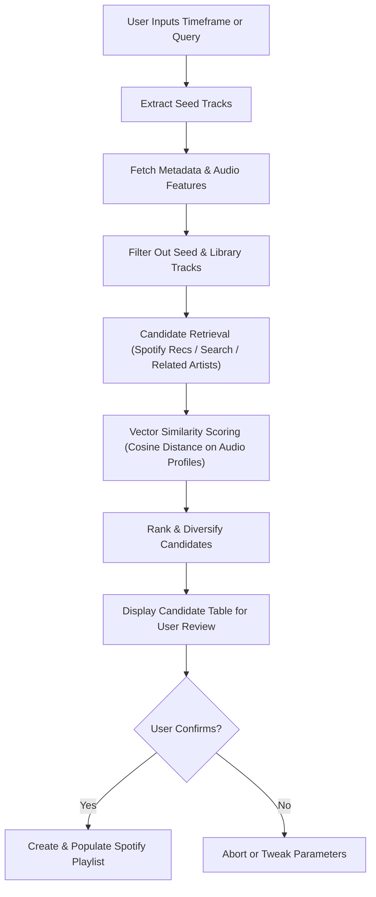

# 🎵 Spotify Time Traveller — Project Specification & Planning Guide

## 1. Project Overview

**Spotify Time Traveller** is an interactive Command Line Interface (CLI) application designed to bridge nostalgia and discovery. It allows users to authenticate with their Spotify account, travel back in time to retrieve the songs they saved, liked, or listened to during a specific timeframe (e.g., `07-2021 : 01-2022`), and automatically generate fresh playlists containing **similar—but never the same—songs**.

In addition to historical timeframe extraction, the application features an open-ended similarity engine where users can seed the algorithm using arbitrary inputs: song titles, album names, artist radio stations, or public playlist URLs.

---

## 2. Core Functional Requirements

### 2.1. Terminal Experience & Interface
- **Terminal Reset**: On startup, clear the terminal screen (`cls` on Windows, `clear` on Unix-like systems).
- **Branding / Splash**: Display a stylized ASCII art logo and brief tagline for *Spotify Time Traveller*.
- **Interactive Navigation**: Use arrow-key navigation menus (via libraries like `rich`, `inquirerpy`, or `questionary`) rather than crude numerical inputs.
- **Progress & Transparency**: Show live spinners and formatted data tables for:
  1. Historical seed tracks identified within the chosen timeframe.
  2. Candidate recommendations matched via the similarity algorithm.
- **Safety Confirmation**: Explicit prompt before any playlist creation or library modification:
  ```text
  Create playlist "Synthwave Nights 2021 (Echoes)" with 30 tracks in your library? [y/N]:
  ```

### 2.2. Authentication & Credentials Management
- **Spotify OAuth 2.0 PKCE / Authorization Code Flow**:
  - Directs user to Spotify login via local browser redirect (`http://localhost:8888/callback`).
  - Scopes required:
    - `user-library-read` (read liked songs and saved tracks)
    - `playlist-read-private`, `playlist-read-collaborative` (read user's created playlists)
    - `playlist-modify-public`, `playlist-modify-private` (create new playlists)
    - `user-read-recently-played` (recent listening context)
- **Token Persistence**: Store credentials and refresh tokens securely in a local `.env` or standard platform keyring/config file (`~/.spotify_time_traveller/credentials.json`).

### 2.3. Input Modes
1. **Timeframe Mode (Time Machine)**:
   - User inputs a date range in flexible formats, e.g., `MM-YYYY : MM-YYYY` (e.g., `07-2021 : 01-2022`) or `YYYY-MM-DD : YYYY-MM-DD`.
   - The system queries tracks added to the user's library (`Saved Tracks`) and user-created playlists where `added_at` falls strictly within the interval.
   - *(Optional Enhancement)* Support importing official Spotify `StreamingHistory*.json` or `endsong*.json` dumps from Spotify Privacy Export for true playback history across years.
2. **Freeform Seed Mode**:
   - User inputs any query:
     - Song name / Track URI
     - Album name / Album URI
     - Artist radio / Artist name
     - Public Playlist name or URL
   - System resolves query to a set of seed tracks.

### 2.4. Customization Parameters
- **Target Song Count**: User specifies desired number of recommendations (default: 30, customizable up to 100).
- **Playlist Metadata**:
  - Name: Custom user input (with automatic smart default like `"Time Traveller: Jul 2021 – Jan 2022 [Echoes]"`).
  - Description: Auto-generated description documenting the time frame or seed query and date of creation.

---

## 3. Similarity & Filtering Algorithm

The core engine finds tracks that capture the musical essence of the seed collection without repeating any track the user already owns or included in the seed list.



### 3.1. Deduplication Rules
- **Rule 1 (Strict Exclusion)**: Any track present in the seed collection must **never** appear in the output.
- **Rule 2 (Library Check)**: (Optional toggle) Exclude all tracks currently present in the user's Liked Songs to prioritize fresh discoveries.
- **Rule 3 (Artist Diversity)**: Cap the maximum number of songs by a single artist (e.g., max 2–3 songs per artist) to avoid monotony.

### 3.2. Similarity Dimensions
Tracks are compared across multiple musical vectors:
- **Audio Features**:
  - `danceability`, `energy`, `valence` (musical mood/positivity)
  - `tempo` (BPM proximity), `acousticness`, `instrumentalness`
- **Artist & Genre Clustering**:
  - Related artists graph (`/v1/artists/{id}/related-artists`).
  - Genre overlap and micro-genre matching.
- **Algorithm Options**:
  - **Option A (Spotify Recommendations API)**: Use target/min/max audio feature parameters derived from mean & variance of seed songs.
  - **Option B (Vector Space / KNN)**: Compute centroid vector of the user's seed tracks in normalized audio-feature space, search candidate pool, and rank by Cosine Similarity.

---

## 4. Technical Architecture & Tech Stack

### 4.1. Recommended Technology Stack
- **Language**: Python 3.11+
- **Spotify SDK**: `spotipy` (or raw `httpx` async client)
- **CLI Framework**:
  - `rich`: Beautiful tables, live spinners, ASCII banner rendering, syntax styling.
  - `inquirerpy` or `questionary`: Interactive arrow-key navigation and input prompts.
  - `typer` or `click`: Command-line parsing, optional CLI flags (e.g., `--from 2021-07 --to 2022-01 --count 50`).
- **Data & Math**: `numpy` / `scikit-learn` for feature normalization and cosine similarity calculation.
- **Configuration**: `pydantic` or `python-dotenv` for config validation and persistence.

### 4.2. Project Directory Structure
```text
spotify-time-traveller/
├── pyproject.toml
├── README.md
├── .env.example
├── config/
│   └── settings.py              # Configuration & API secrets
├── src/
│   ├── __init__.py
│   ├── main.py                  # Entry point & CLI loop
│   ├── ui/
│   │   ├── banner.py            # ASCII logo & splash screen
│   │   ├── console.py           # Rich console themes & prompts
│   │   └── tables.py            # Formatted seed & candidate tables
│   ├── auth/
│   │   └── spotify_oauth.py     # OAuth PKCE flow & token management
│   ├── spotify/
│   │   ├── client.py            # Spotipy / Web API wrappers
│   │   ├── history_extractor.py # Filter tracks by added_at timeframe
│   │   ├── resolver.py          # Resolve songs/albums/radios/playlists
│   │   └── playlist_creator.py  # Create and commit new playlists
│   └── engine/
│       ├── audio_features.py    # Feature extraction & profiling
│       ├── similarity.py        # Vector similarity & candidate ranking
│       └── filters.py           # Deduplication & artist caps
└── tests/
    ├── test_history_filter.py
    └── test_similarity.py
```

---

## 5. User Journey & CLI Flow (Walkthrough)

```text
+-------------------------------------------------------------+
|                                                             |
|   ███████╗██████╗  ██████╗ ████████╗██╗███████╗██╗   ██╗    |
|   ██╔════╝██╔══██╗██╔═══██╗╚══██╔══╝██║██╔════╝╚██╗ ██╔╝    |
|   ███████╗██████╔╝██║   ██║   ██║   ██║█████╗   ╚████╔╝     |
|   ╚════██║██╔═══╝ ██║   ██║   ██║   ██║██╔══╝    ╚██╔╝      |
|   ███████║██║     ╚██████╔╝   ██║   ██║██║        ██║       |
|   ╚══════╝╚═╝      ╚═════╝    ╚═╝   ╚═╝╚═╝        ╚═╝       |
|                   T I M E   T R A V E L L E R               |
|                                                             |
+-------------------------------------------------------------+

[?] Select an action:
 > ⏳ Travel in Time (Timeframe filter)
   🔍 Similarity by Song / Album / Artist
   📻 Similarity by Radio / Public Playlist
   📁 Import Spotify History Archive (.json)
   ⚙️ Settings & Credentials
   🚪 Exit

--- Scenario: User picks "Travel in Time" ---

[?] Enter start date (MM-YYYY or YYYY-MM-DD): 07-2021
[?] Enter end date (MM-YYYY or YYYY-MM-DD):   01-2022
[?] Target playlist size: 30
[?] Playlist title: Synthwave Echoes 2021

[⠋] Scanning Liked Songs and Playlists between 2021-07-01 and 2022-01-31...
[✓] Found 42 tracks added in that timeframe!

+----+----------------------------+----------------------+---------------+
| #  | Track Title                | Artist               | Date Added    |
+----+----------------------------+----------------------+---------------+
| 1  | Midnight City              | M83                  | 2021-08-14    |
| 2  | Resonance                  | HOME                 | 2021-09-02    |
| 3  | Tech Noir                  | Gunship              | 2021-11-20    |
| ...| ...                        | ...                  | ...           |
+----+----------------------------+----------------------+---------------+

[⠋] Running similarity engine (calculating acoustic profile & querying)...
[✓] Generated 30 similar, non-duplicate recommendations!

+----+----------------------------+----------------------+---------------+
| #  | Recommended Track          | Artist               | Match Score   |
+----+----------------------------+----------------------+---------------+
| 1  | Days of Thunder            | The Midnight         | 96.4%         |
| 2  | Endless Summer             | FM-84                | 94.8%         |
| 3  | Sunset                     | The Midnight         | 92.1%         |
| ...| ...                        | ...                  | ...           |
+----+----------------------------+----------------------+---------------+

[?] Ready to save "Synthwave Echoes 2021" (30 tracks) to your Spotify account? (Y/n) > Y
[✓] Success! Playlist created: https://open.spotify.com/playlist/37i9dQZF1DXcBWIGoYBM5M
```

---

## 6. Implementation Phases for Antigravity

| Phase | Milestone | Deliverables |
|---|---|---|
| **Phase 1** | **Project Scaffolding & Setup** | `pyproject.toml`, folder layout, environment variable setup, Rich CLI theme. |
| **Phase 2** | **Spotify OAuth Integration** | Complete authorization workflow with local callback server, token storage & refresh. |
| **Phase 3** | **Data Ingestion & Filtering** | Implement date-based `added_at` scanning for Liked Songs (`/me/tracks`) and User Playlists (`/me/playlists`). |
| **Phase 4** | **Query Resolvers** | Parsers for track, album, artist radio, and public playlist URLs into standardized track seed sets. |
| **Phase 5** | **Similarity Engine** | Audio feature aggregation, candidate track retrieval, cosine similarity ranking, strict duplicate removal. |
| **Phase 6** | **Interactive CLI UI** | Full ASCII banner, Inquirer selection menus, formatted Rich tables, confirmation flow. |
| **Phase 7** | **Spotify Sync & Testing** | Endpoint call to create playlist and append track URIs; end-to-end integration and mock unit tests. |

---

## 7. Special Considerations & Constraints

1. **Spotify API Rate Limits**:
   - Spotify enforces 429 Too Many Requests with a `Retry-After` header. All client calls should implement exponential backoff.
2. **Audio Features Endpoint Changes**:
   - Spotify announced phased deprecations and access restrictions for some developer API endpoints (such as public audio-features / recommendations). As a resilient design:
     - Primary: Spotify Recommendations / Audio Features API.
     - Fallback: Related Artists scraping + Top Tracks aggregation + Last.fm / MusicBrainz API integration.
3. **Playback History vs. Added Date**:
   - The official Spotify `/me/player/recently-played` API endpoint **only returns the user's last 50 tracks**.
   - Therefore, the application leverages `added_at` timestamps from **Saved Tracks (`/me/tracks`)** and **User Playlists** to reconstruct historical listening periods accurately.
   - For users wanting true listening counts over years, providing an optional file-drop for Spotify's `endsong.json` GDPR export provides 100% precision.
